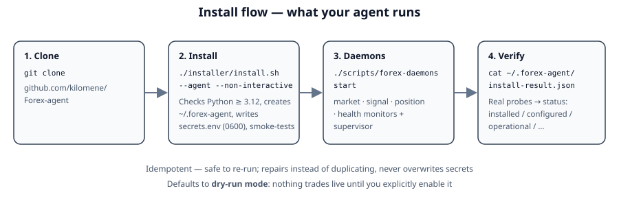
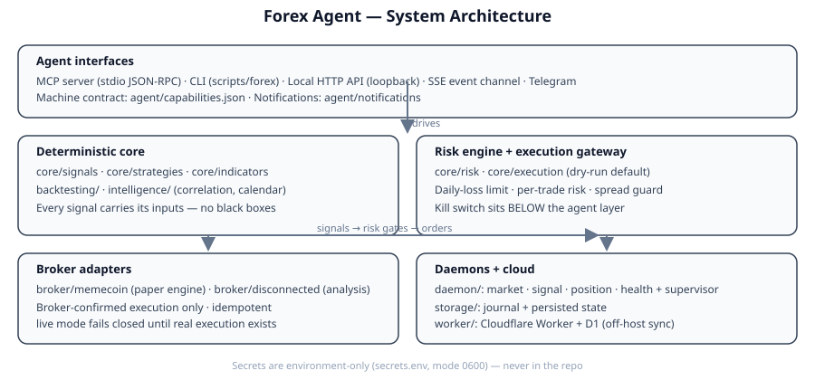
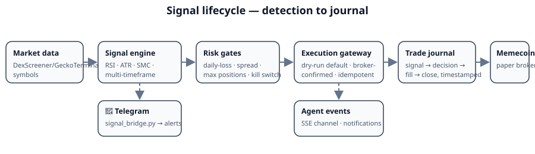

# Forex Agent

[](https://github.com/kilomene/Forex-agent/actions/workflows/build.yml)
[](https://github.com/kilomene/Forex-agent/releases)


An **agent-native trading subsystem**: deterministic market analysis, signal detection, and a paper-by-default execution gateway that your AI agent can install, operate, and monitor — over MCP, a CLI, a local HTTP API, and Telegram. Execution runs on the built-in **memecoin provider**: a self-contained paper engine (10 SOL virtual balance) with keyless public market data (DexScreener quotes, GeckoTerminal candles) — no broker account, no SDK, no private keys.

> ⚠️ **Demo / research software.** This project is built for research and automation experiments. Paper mode moves no real money. Live mode is intentionally fail-closed until real execution exists. It is not financial advice.

---

## 🤖 Install with your AI agent (recommended)

Copy-paste this to your agent:

```
Install the Forex agent from https://github.com/kilomene/Forex-agent
end to end: install everything on your own — the core subsystem,
the memecoin paper engine, and the bridge daemons — launch it all,
verify it's healthy, and leave trading in paper mode. When everything
is running, ask me for the configuration you need (risk settings).
```

### What your agent installs and launches on its own

1. **Core subsystem** — clones the repo and runs `./installer/install.sh --agent --non-interactive`: verifies Python ≥ 3.12, creates the agent home (`~/.forex-agent`), smoke-tests the manifest, MCP server, and CLI. The installer is **idempotent** — safe to re-run; it repairs instead of duplicating and never overwrites your secrets file.
2. **Memecoin paper engine** — needs no credentials: the `memecoin` provider starts with a 10 SOL virtual balance, persists state under the agent home, and journals every fill. Market data comes from public DexScreener/GeckoTerminal endpoints over stdlib HTTP.
3. **Bridge daemons** — launches the signal bridge (Telegram alerts), the trade executor (risk-gated execution + full journaling), and the daemon supervisor.
4. **Verification** — probes the real state (feed freshness, daemon liveness, broker status, kill-switch state) and reports a machine-readable status (`installed`, `configured`, `operational`, `needs_credentials`, …).

### Then it asks you for configuration

Only the human-only bits need you — your agent will ask for:

- **Telegram** — bot token and chat ID, if you want signal/trade alerts
- **Risk settings** — per-trade risk %, daily-loss limit, max concurrent positions (sensible defaults are already in place)
- **Paper symbols** — which memecoin mints to watch (defaults are in place)

Paper mode needs **no broker credentials and no private keys** — the memecoin provider is keyless by design. Live mode is fail-closed and additionally requires explicit arming plus a wallet **public** address (never a private key).

Secrets go to the environment / `secrets.env` (mode `0600`) — never into the repo, logs, or chat.



---

## What it does

```
Market data → Indicators → Signals → Risk gates → Execution gateway → Broker
                  ↓                                              ↓
            Telegram alerts                                Trade journal
```

- **Signal engine** — deterministic technical analysis (RSI, ATR, SMC concepts, multi-timeframe strategies) across a configurable symbol watchlist. No black boxes: every signal carries its inputs.
- **Risk engine** — equity-based daily-loss limit, per-trade risk %, volume step clamping, max concurrent positions, spread guard, per-symbol and correlation blocking, kill switch. The kill switch sits *below* the agent layer — no prompt can trade through it.
- **Execution gateway** — paper by default. Live orders fail closed until real execution exists. Every paper fill is broker-confirmed and idempotent, with a JSONL fill journal.
- **Agent interfaces** — MCP server (stdio), CLI (`scripts/forex`), loopback-only local HTTP API with an SSE event channel, and an agent notification bridge (Telegram included).
- **Daemons** — market, signal, position, and health monitors with a supervisor and optional systemd units.
- **Cloud layer** (`worker/`) — a Cloudflare Worker (`forex-control-plane`) with D1 storage for syncing state off-host.



---

## Repository layout

```
.
├── agent/            # Agent interfaces: MCP server, event bus, notifications, tools
├── backtesting/      # Offline strategy backtesting engine
├── broker/           # Broker adapters (memecoin paper engine; disconnected stub for analysis)
├── config/           # Configuration loading + defaults
├── core/             # Signals, strategies, indicators, risk, execution, reconciliation
├── daemon/           # Background monitors + supervisor + systemd units
├── docs/             # Deep-dive docs (architecture, install, security, operations…)
├── installer/        # Idempotent Linux installer
├── intelligence/     # Correlation, economic calendar, experience learning
├── scripts/          # CLI (forex), daemon control, local API, manifest generator
├── storage/          # Journal + state persistence
├── tests/            # Full pytest suite
└── worker/           # Cloudflare Worker: API, D1 schema/migrations, contract tests
```

Start with the docs: [ARCHITECTURE](docs/ARCHITECTURE.md) · [INSTALL](docs/INSTALL.md) · [CONFIGURATION](docs/CONFIGURATION.md) · [OPERATIONS](docs/OPERATIONS.md) · [SECURITY](docs/SECURITY.md) · [TELEGRAM_SETUP](docs/TELEGRAM_SETUP.md) · [AGENT_INTEGRATION](docs/AGENT_INTEGRATION.md)

---

## Requirements

- **Linux** (first-class), **Python 3.12+** — stdlib only, no pip dependencies for the core.
- **Node 18+** — only if you want to run the Worker contract tests or deploy the Worker.

No broker account or credentials are needed: the default `memecoin` provider runs a self-contained paper engine and reads keyless public market data.

---

## Manual install

```bash
git clone https://github.com/kilomene/Forex-agent
cd Forex-agent
./installer/install.sh --agent --non-interactive --prefix ~/.forex-agent
cat ~/.forex-agent/install-result.json
```

Then start the daemons:

```bash
./scripts/forex-daemons start
./scripts/forex-daemons status
```

Useful flags: `--skip-daemons` (install only), `--system` (as root: install systemd units + a `forex` user), `--prefix DIR` (custom home). Full reference in [docs/INSTALL.md](docs/INSTALL.md).

### Verify it

```bash
python3 -m pytest tests/ -q            # full pytest suite
node --test "worker/tests/*.test.mjs" # 20 contract tests
bash installer/test_idempotent.sh      # installer checks
```

CI runs all of this on every push and pull request.

---

## Configuration

All runtime state lives under `$FOREX_AGENT_HOME` (default `~/.forex-agent`):

| File | Purpose |
|---|---|
| `secrets.env` | API secrets (e.g. `WORKER_API_KEY`), mode `0600`, never overwritten |
| `agent.env` | Non-secret defaults (provider, symbols, paper mode) |
| `data/memecoin/` | Memecoin paper state: balance, positions, fill journal, idempotency store, kill-switch file |
| `run/` | Daemon state, cursors, journal |
| `log/` | Daemon logs |
| `install-result.json` | Machine-readable install status |

Provider selection: `BROKER_PROVIDER` is `memecoin` (default) or `disconnected` (analysis-only). Paper mode needs no credentials. Live mode additionally requires `MEMECOIN_LIVE_ARMED=1` and `MEMECOIN_WALLET_PUBKEY` (a wallet **public** address — private keys are never requested, received, or stored). See [docs/CONFIGURATION.md](docs/CONFIGURATION.md), [docs/SECURITY.md](docs/SECURITY.md), and [broker/memecoin/RUNTIME.md](broker/memecoin/RUNTIME.md).

---

## Using it

**CLI:**

```bash
./scripts/forex status
./scripts/forex health
./scripts/forex broker-status
./scripts/forex signals --json
./scripts/forex positions
```

**MCP (for agents):** spawn `python3 -m agent.mcp.server` from the repo root and speak JSON-RPC 2.0 over stdio (`initialize`, `tools/list`, `tools/call`).

**Local API + SSE:** `scripts/local_api.py` serves a loopback-only HTTP API; the SSE channel streams agent events with IDs, severities, and reconnect/resume replay.

**Machine contract:** `agent/capabilities.json` is the machine-readable capability manifest — point your agent at it.

---

## 🔔 Telegram alerts

The signal bridge watches the signal feed and pushes formatted alerts to Telegram in real time:

```
🔔 Signal: BONK M15 BUY @ 0.0000234, RSI 36.1
```

Setup walkthrough: [docs/TELEGRAM_SETUP.md](docs/TELEGRAM_SETUP.md). Trade opens/closes are journaled and can raise their own alerts (`🟢 Opened:` / `🔴 Closed: … P&L`).



---

## 📈 Paper trading (memecoin provider)

The `memecoin` provider (`broker/memecoin/`) is a self-contained paper engine:

- **10 SOL virtual starting balance** (configurable via `MEMECOIN_PAPER_START_SOL`), persisted under `$FOREX_AGENT_HOME/data/memecoin/`
- **Spot BUY + reduce-only FIFO SELL**, SL/TP modify, close, full position/order/deal history
- **JSONL fill journal** (`fills.jsonl`) with idempotent replay — restarts and crashes never double-count fills
- **Kill-switch file** coupling: a `killswitch` file blocks new submissions (risk-reducing closes still work); `KillSwitch.close_all()` flattens everything
- **Keyless market data** — DexScreener token quotes and GeckoTerminal OHLCV over stdlib `urllib`; no API keys, no new dependencies. If market data is unreachable the engine refuses to price fills and degrades honestly instead of trading blind.
- **No private keys** — only a wallet public address may be configured, and only for the (fail-closed) live path.

**Live mode is intentionally fail-closed**: `connect()` in live mode always raises `BROKER_UNAVAILABLE` until real execution exists. Paper mode is the default and moves no real money.

Full runtime contract: [broker/memecoin/RUNTIME.md](broker/memecoin/RUNTIME.md).

---

## ☁️ Worker (cloud sync layer)

The Cloudflare Worker in `worker/` exposes the control-plane API backed by D1. To deploy:

1. Create a D1 database and put its ID in `worker/wrangler.toml` (replacing the placeholder).
2. Add a `CLOUDFLARE_API_TOKEN` secret in the repo's **Settings → Secrets**.
3. Push a change under `worker/**` (or run the workflow manually) — `.github/workflows/deploy-worker.yml` runs the contract tests, then `wrangler deploy`.

Contract: [worker/CONTRACT.md](worker/CONTRACT.md).

---

## Safety model

- **Paper default.** The memecoin provider starts in paper mode with virtual SOL; nothing touches real funds.
- **Live fails closed.** Live mode raises `BROKER_UNAVAILABLE` until real execution exists — there is no path from the current code to a real-money fill.
- **Keyless by design.** No private keys are requested, received, stored, or handled anywhere. Only a wallet public address may be configured.
- **Kill switch below the agent.** The kill-switch file halts new submissions regardless of what any agent requests, while still allowing risk-reducing closes.
- **Broker-confirmed execution.** Fills are only recorded when the fill is journaled; reconciliation catches anything else. Replay is idempotent.
- **Secrets are environment-only.** They never enter the repo, logs, or chat.
- **Full journaling.** Every signal, decision, rejection, fill, and close is timestamped and persisted — nothing trades silently.

Read [docs/SECURITY.md](docs/SECURITY.md) before going further.

---

## Contributing

Issues and pull requests are welcome. CI must stay green: run the test commands above before pushing. Do not commit secrets, tokens, `run/` state, logs, backups, or compiled binaries — see `.gitignore`.

## License

No license file is committed yet — add a `LICENSE` to set the terms (e.g. MIT, Apache-2.0). Demo/research software; not financial advice.
